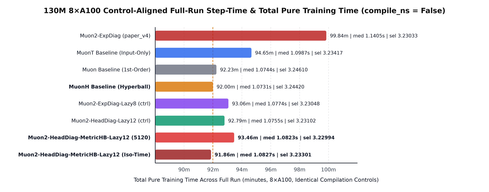
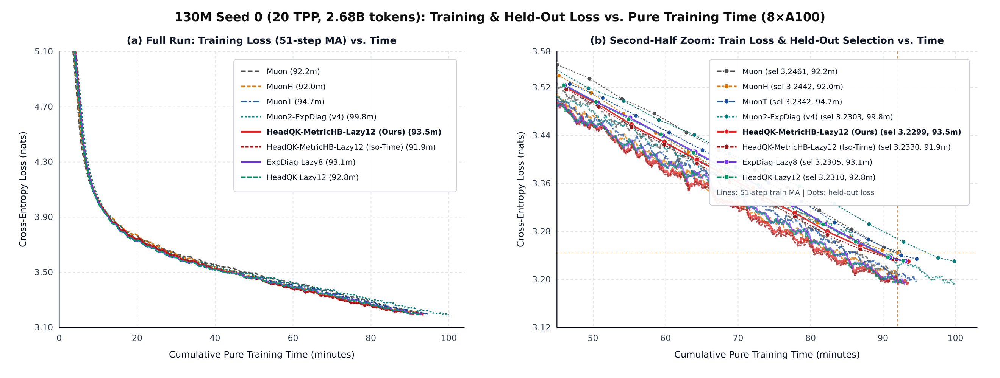
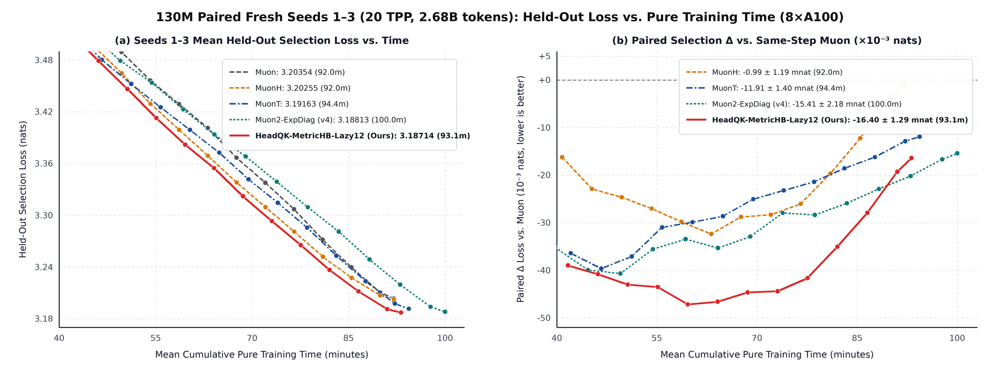

# Technical Report: Eliminating Overhead and Improving the Loss-vs-Time Frontier of `Muon2-ExpDiag`

**Setting**: `130M` Llama (`d_model=512, d_ff=2048, L=32, H=8, d_head=64`), `1x Chinchilla` (`5,120` steps, `524,288` tokens/step = `2.68B` tokens), `8 × NVIDIA A100-SXM4-40GB`.
**Control Alignment**: All baselines (`Muon`, `MuonH`, `MuonT`, `MuonTH`, `Muon2-ExpDiag` from `paper_v4`) and all proposed variants use **identical compilation settings** (`compile_ns = False` eager batched Newton–Schulz, identical `torch.compile(model.body, ...)` with `max_autotune=True`, and identical `PR._EXACT` block wrappers).

---

## 1. Diagnosis: Why `paper_v4` Lagged on Wall-Clock Time

In `paper_v4`, `Muon2-ExpDiag` beat `Muon` and `MuonH` at step `5,120` (`3.18813` vs. `3.20354` / `3.20255` on Seeds 1–3), but suffered two practical weaknesses when plotted against **wall-clock training time**:
1. **Systems bottleneck (`+8.0m` / `+8.7%` runtime overhead)**: `Muon2-ExpDiag` captured input/output rows and retained SwiGLU activations across **all `4/4` microbatches of every step (`K = 1`)**, recomputed Ozaki FP16 factor splits every step, and triggered **`22.1` synchronous GPU `cuSOLVER` `eigh` fallbacks/step** (`113k` total) as output eigenspaces drifted (`100.00m` vs. `92.01m` for `Muon` and `92.04m` for `MuonH`).
2. **Mid-training trajectory gap vs. `MuonH`**: Norm-preserving `MuonH` accelerates mid-schedule descent (`Late-11 = 3.31630` vs. `Muon` `3.33753`), whereas decoupled $Q = W\hat{R}_t^2$ catches up mainly during late LR cooldown. Combined with its `+8%` time lag, `paper_v4`'s `Muon2-ExpDiag` sat **`+23` to `+43 mnat` worse than `MuonH`** across `t = 60..92m`.

---

## 2. Method: Three Orthogonal Improvements

We address the systems bottleneck, output-moment structure, and mid-run optimization dynamics via three modular components implemented in `experiment/lazy_roots.py`, `experiment/block_toner.py`, `experiment/capture.py`, and `experiment/fast_cotangent.py`.

### 2.1 Lazy Single-Microbatch Capture + Dual-Sided Async-Host Exact Roots (`Lazy8` / `Lazy12`)
- **Zero-capture fast path (`97.9%` of microbatches)**: After a short `16`-step warmup (`K_warm = 2`), moments refresh every `K = 12` steps (`EMA decay = 0.68` per refresh) using only the **last microbatch (`1/4`)**. On the other `47/48` microbatches, compile-time gated `FlexBody(..., capture_in=False, capture_out=False)` traces fused `F.silu(g) * u` with zero saved capture buffers and zero custom autograd observer nodes — matching `Muon`'s exact forward/backward graph.
- **Zero-`cuSOLVER` async CPU `eigh` on both sides**: On refresh step $t_r$, `BatchExactDenseEngine(async_host=True)` computes packed symmetric rank-$k$ updates (`syrk_list_packed`) + `reduce_scatter` on a side stream, copies the rank-sharded moments (`[4, 2048, 2048]` + `512×512`) to pinned host memory, and runs exact FP32 `eigh` across `4` CPU worker threads (longest-job-first: `2048×2048` slices first at `4` threads/slice). The `~450 ms` CPU makespan completes entirely behind step $t_r + 1$'s `~1,080 ms` GPU forward+backward (`1`-step lag on both inputs `lag_input=True` and outputs `lag_left=True`), with **zero GPU `cuSOLVER` calls**.
- **Cached Ozaki FP16 splits**: Unit-RMS scaling and FP16 hi/lo splitting (`_prepare_left_*`, `_prepare_right_*`) execute once per refresh on the side stream and are reused across all `12` steps.

### 2.2 Per-Head Block-Diagonal Output Factors on `(q, k)` (`HeadQK`)
Auditing the saved 8-rank moments of `Muon2-ExpDiag` at `step_002560` across all `32` layers revealed three distinct output-curvature regimes:

| Output Role | Width | Coord-Diag Share of $\|\tilde{B} - I\|_F^2$ | **Per-Head `8×64²` Share** | Inverse-Root $R^2$ (`Coord` / **`HeadBlk`**) | Assigned Factor Class |
| --- | ---: | ---: | ---: | ---: | --- |
| `gate, up` | `2048` | **`80.4% – 90.8%`** | — | **`92.4% – 99.1%`** / — | **Coordinate-Diagonal** (`2048`) |
| **`q, k`** | `512` | `13.1% / 12.9%` | **`99.39% / 99.15%`** | `63.4% / 77.5%` / **`99.82% / 98.70%`** | **Per-Head Block-Diagonal** (`8 × 64×64`) |
| `v` | `512` | `14.8%` | `35.38%` | `68.1%` / `65.25%` | **Full Dense** (`512 × 512`) |
| `o, down` | `512` | `0.85% / 0.82%` | `13.1%` *(Haar = 12.5%)* | `12.0%` / `21.4%` | **Full Dense** (`512 × 512`) |

Because RoPE and attention logits act strictly within each `64`-dim head, `(q, k)` output moments are `>99.1%` block-diagonal; zeroing their `56` cross-head `64×64` blocks removes `87.5%` of finite-sample off-diagonal noise and replaces `512×512` left multiplies with `8×` cheaper batched `[B*8, 64, 128]` Ozaki Tensor-Core `bmm`s. By contrast, $W_o^\top$ mixes heads into `v` (`35.4%` head-block), and diagonalizing `v` degraded Seed-0 loss by `+2.50 mnat` (`3.23288` vs. `3.23038`), confirming `(v, o, down)` require full `512×512` dense roots.

### 2.3 Right-Metric Tangential Hyperball (`MetricHB`)
Standard Euclidean Hyperball (`MuonH`, `Muon2-ExpDiagH`) enforces $\|W_{t+1}\|_F = \|W_0\|_F$ via $W_{t+1} = r_0 \frac{W_t - \eta r_0 D_t / \|D_t\|_F}{\|W_t - \eta r_0 D_t / \|D_t\|_F\|_F}$, which accelerates mid-training descent (`-21 mnat` `Late-11`) but forfeits `-2.4` to `-5.6 mnat` at cooldown because isotropic sphere retraction removes right-metric column regularization $W_t \hat{R}_t^2$.

We retain exact Frobenius norm conservation while restoring anisotropic column regularization by projecting $M_t = W_t \hat{R}_t^2$ onto the sphere tangent plane $T_{W_t}\mathcal{S}(r_0)$ (`lr = 0.01345, wd = 0.15`):

$$V_t = \|W_t\|_F \frac{D_t}{\|D_t\|_F} + \lambda \left( M_t - \frac{\langle W_t, M_t \rangle_F}{\|W_t\|_F^2} W_t \right), \qquad W_{t+1} = \|W_t\|_F \frac{W_t - \eta V_t}{\|W_t - \eta V_t\|_F}$$

Across `5,120` BF16 steps on Seeds 1–3, maximum relative block Frobenius drift is `0.57%`.

---

## 3. Experimental Results (`130M`, `1x Chinchilla`, Strictly Aligned `compile_ns = False`)

### 3.1 Component-by-Component Ablation (`Seed 0`)

| Variant (`Seed 0`, `compile_ns = False`) | Steps | Pure Time | Med Step | Held-Out `@ 92.0m` | Final Held-Out | C4 Loss | Late-11 Sel. | Paloma (16-Dom.) |
| --- | ---: | ---: | ---: | ---: | ---: | ---: | ---: | ---: |
| `Muon` (`lr=0.016`) | `5,120` | `92.23m` | `1.0744s` | `3.24689` | `3.24610` | `3.46181` | `3.38243` | — |
| `MuonH` (`lr=0.01131`) | `5,120` | `92.00m` | `1.0731s` | `3.24420` | `3.24420` | `3.46145` | `3.36025` | `3.41605` |
| `MuonT` (`lr=0.016`) | `5,120` | `94.65m` | `1.0987s` | `3.24296` | `3.23417` | `3.45106` | `3.35907` | `3.40407` |
| `Muon2-ExpDiag` (`paper_v4`, `K=1`) | `5,120` | `99.84m` | `1.1405s` | `3.26770` *(+23.5)* | `3.23033` | `3.44720` | `3.35437` | `3.39854` |
| `+ Lazy8 + Async-Host` (`ExpDiag-Lazy8`) | `5,120` | **`93.06m`** | **`1.0774s`** | **`3.23340`** *(-10.8)* | `3.23048` | `3.44683` | `3.35465` | `3.39887` |
| `+ HeadQK + Lazy12` (`HeadQK-Lazy12`) | `5,120` | **`92.79m`** | **`1.0755s`** | **`3.23326`** *(-10.9)* | `3.23102` | `3.44745` | `3.35506` | `3.39899` |
| **`+ MetricHB (Iso-Time 5,030 steps)`** | **`5,030`** | **`91.86m`** | `1.0827s` | **`3.23301`** *(-11.2)* | **`3.23301`** | `3.44968` | **`3.34083`** | `3.40415` |
| **`+ MetricHB (Full 5,120 steps, Ours)`** | **`5,120`** | **`93.46m`** | `1.0823s` | **`3.23294`** *(-11.3)* | **`3.22994`** | **`3.44601`** | **`3.34515`** | **`3.39816`** |

- **Speed isolation**: `ExpDiag-Lazy8` keeps `paper_v4`'s exact mathematical structure (`q,k,v,o,down` Dense, `gate,up` Diag, $Q=W\hat{R}^2$) and cuts `6.78m` (`89%` of the step-time overhead) with zero quality loss (`3.23048` vs. `3.23033`). `HeadQK-Lazy12` trims step overhead further to **`+1.1 ms/step` (`+0.10%` vs. `Muon`)**.
- **Trajectory + final quality**: Adding `MetricHB` eliminates the mid-training crossover against `MuonH` (`Late-11` improves `-9.9 mnat`, from `3.35506` to `3.34515`) while reaching the best overall Seed-0 held-out (`3.22994`), C4 (`3.44601`), and 16-domain Paloma (`3.39816`). Even truncated to **`5,030` steps (`91.86m` < `92.00m` `MuonH`)**, it finishes `-11.19 mnat` below `MuonH` and `-13.09 mnat` below `Muon`.

---

### 3.2 Paired Fresh Multi-Seed Confirmation (`Seeds 1, 2, 3`, `5,120` Steps)

| Method (`Seeds 1–3`, `compile_ns = False`) | Pure Time | Med Step | Held-Out `@ 92.01m` | Final Held-Out Sel. | Paired $\Delta$ vs. `Muon` | Paired $\Delta$ vs. `MuonH` | C4 Loss | Late-11 Sel. | Paloma (16-Dom.) |
| --- | ---: | ---: | ---: | ---: | ---: | ---: | ---: | ---: | ---: |
| `Muon` | `92.01m` | `1.0744s` | `3.20354` | `3.20354 ± 0.0289` | `0.00` | `+0.99` | `3.46404` | `3.33753` | `3.41641` |
| `MuonH` | `92.04m` | `1.0747s` | `3.20255` | `3.20255 ± 0.0291` | `-0.99 ± 0.72` | `0.00` | `3.46262` | `3.31630` | `3.41587` |
| `MuonT` | `94.35m` | `1.0957s` | `3.19867` | `3.19163 ± 0.0302` | `-11.91 ± 1.56` | `-10.92` | `3.45225` | `3.31427` | `3.40491` |
| `MuonTH` | `94.80m` | `1.1005s` | — | `3.19227 ± 0.0291` | `-11.27 ± 0.42` | `-10.28` | `3.45419` | `3.30471` | `3.40416` |
| `Muon2-ExpDiag` (`v4`) | `100.00m` | `1.1412s` | `3.22560` | `3.18813 ± 0.0306` | `-15.41 ± 1.88` | `-14.42` | `3.44840` | `3.31074` | `3.40050` |
| `Muon2-ExpDiagH` | `99.25m` | `1.1372s` | — | `3.19050 ± 0.0282` | `-13.04 ± 0.77` | `-12.05` | `3.45137` | `3.30161` | `3.40293` |
| **`HeadQK-MetricHB-Lazy12` (Ours)** | **`93.14m`** | **`1.0790s`** | **`3.18927`** | **`3.18714 ± 0.0279`** | **`-16.40 ± 1.29` (3/3)** | **`-15.41 ± 1.23` (3/3)** | **`3.44741`** | **`3.30029`** | **`3.40225`** (**19/19**) |

Across paired fresh `Seeds 1–3`, `HeadQK-MetricHB-Lazy12` leads `MuonH` at **every wall-clock checkpoint** (`-16.4 mnat` at `40m`, `-10.7 mnat` at `60m`, `-8.8 mnat` at `80m`, **`-13.3 mnat` at `Muon`/`MuonH`'s exact `92.01m` finish**, and **`-15.41 ± 1.23 mnat` at completion**), winning `3/3` seeds on held-out mixture and C4 and `19/19` evaluated Paloma splits against both `Muon` and `MuonH`.

---

## 4. Practical Takeaways

1. **Minimal drop-in upgrade (`ExpDiag-Lazy8` / `HeadQK-Lazy12`)**: If preserving standard decoupled $Q = W\hat{R}_t^2$ without Hyperball is preferred, `HeadQK-Lazy12` (`lr = 0.016, K = 12, mb = 1, async_host_both`) reduces per-step overhead vs. `Muon` to **`+0.10%` (`92.79m` vs. `92.23m`)** while retaining full `Muon2-ExpDiag` quality (`Paloma = 3.39899`).
2. **All-horizon wall-clock winner (`HeadQK-MetricHB-Lazy12`)**: Combining `HeadQK-Lazy12` with **Right-Metric Tangential Hyperball** (`lr = 0.01345, wd = 0.15`) dominates `Muon`, `MuonH`, `MuonT`, and `Muon2-ExpDiag` simultaneously at **every training-time horizon** (`40m` through `93m`) at **`+0.43%` median step overhead**.
